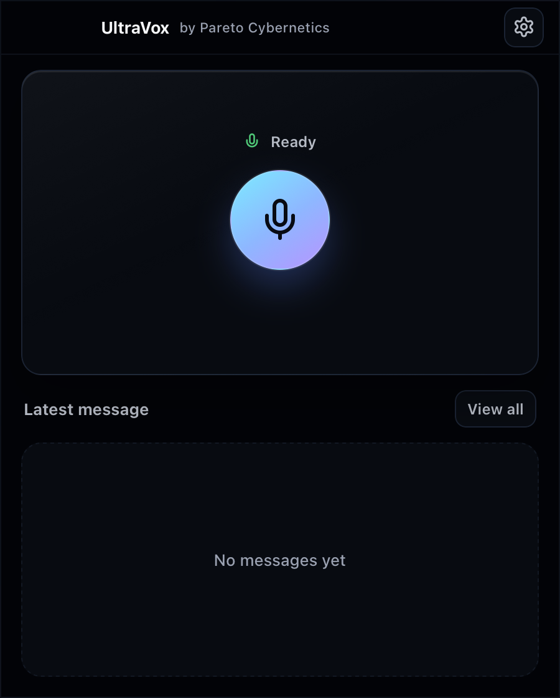

# UltraVox

Private speech-to-text for Mac. Dictate into any app and transcribe meetings, lectures and media. Your recordings never leave your computer.

<p align="center">
  
</p>

<p align="center">
  <a href="https://github.com/michael-berardi/ultravox/releases/tag/v0.13.4"><strong>Download for Mac</strong></a>
  ·
  <a href="#privacy">Privacy</a>
  ·
  <a href="#contributing">Contributing</a>
</p>

## What it does

- **Dictate into any app.** Press a global shortcut, speak, and press it again. The text is inserted where you were typing. You can also hold the shortcut to record.
- **Transcribe files and links.** Drop in an audio file or paste a media URL.
- **Works offline.** Download an English or multilingual model once. After that, transcription runs on your Mac with no connection.
- **Keeps a local history.** Search, copy, export, retry or delete past transcripts.
- **Custom dictionary.** Corrects names and technical terms. [An agent skill](docs/dictionary.md) can review it for you.
- **Works with UltraTerm.** When UltraTerm is the frontmost app, the shortcut sends your voice to UltraTerm instead.

### Free and Pro

UltraVox is free and open source. An optional Pro license ($25, one time) supports development and unlocks:

- **Meeting mode:** system audio and microphone.
- **Lecture mode:** system audio only.
- **Voice Studio:** on-device voice cloning and speech generation. See the [Voice Studio guide](docs/voice-studio.md).
- **Vocabulary from your Retex vaults.**
- **All themes.** Midnight (the default), Silver Rack, Nord Frost, Vapor and Obsidian Rite are free.

Buy a license or start a 14-day trial in **Settings → Pro**.

## Install

1. Download `UltraVox-macos-arm64.pkg` (installer) or `UltraVox-macos-arm64.zip` from the [latest release](https://github.com/michael-berardi/ultravox/releases/tag/v0.13.4).
2. Open the installer, or unzip the archive and move `UltraVox.app` to `/Applications`. Releases are signed with a Developer ID and notarized by Apple.
3. To verify a download, put the file and its `.sha256` file in one folder and run `shasum -a 256 -c UltraVox-macos-arm64.pkg.sha256`.

Files named `UltraVox-Light-*` and `UltraVox-Pro-*` are the same build under older names, kept so existing installs can update. You only need the plain `UltraVox-macos-arm64` files.

On first launch, grant only what your workflow needs:

- **Microphone** to record speech.
- **Accessibility** to insert text into other apps or use a modifier-only shortcut.
- **Screen Recording** for Meeting mode and Lecture mode (Pro).

Then pick a model, set a shortcut in **Settings → Shortcut**, and start talking.

## Platforms

- **macOS 14 or later on Apple Silicon.** Meeting mode and Lecture mode need macOS 15 or later.
- **Windows and Linux:** the current releases do not include builds. The last Windows build is 0.12.4 and the last Linux build is 0.11.0; both remain on the [Releases](https://github.com/michael-berardi/ultravox/releases) page.

## Privacy

- Recordings, transcripts and the dictionary stay on your Mac. Transcription runs on-device.
- UltraVox uses the network to download models, to fetch media you import by URL, to check for updates and, with Pro, to activate your license.
- Anonymous usage statistics are off until you turn them on in **Settings → Privacy**. They never include audio, transcripts, URLs or file paths.
- Retex vocabulary (Pro) runs the local `retex` command read-only on folders you choose. Transcripts are never sent to Retex.

## Updates

UltraVox checks for a new version at launch and every four hours, and shows an **Update** button when one is available. **Settings → Updates → Automatically update** installs new versions while the app is idle, never during a recording. Every download is checked against its SHA-256 checksum and Apple code signature before it is installed. If a check fails, your installed version is left untouched.

## Build from source

The open-source build does not include the Pro module. You need Node.js 22, pnpm 10, Rust, CMake, libomp and the Xcode Command Line Tools.

```bash
git clone --recurse-submodules https://github.com/michael-berardi/ultravox.git
cd ultravox
brew install cmake libomp rust node@22
export PATH="$(brew --prefix node@22)/bin:$PATH"
npm install --global pnpm@10.27.0
pnpm install --frozen-lockfile

pnpm desktop:check
cargo test --workspace
pnpm test:all

pnpm --filter ultravox-desktop tauri build --no-default-features --features custom-protocol
```

A local build is ad-hoc signed, so macOS treats it as a different app from the official release and asks for permissions again. Do not install it over `/Applications/UltraVox.app`.

## Contributing

Issues and focused pull requests are welcome. See [CONTRIBUTING.md](CONTRIBUTING.md), and report security problems privately as described in [SECURITY.md](SECURITY.md). Please do not include recordings, transcripts, credentials or personal system details in issues.

## License

UltraVox source is available under the [MIT License](LICENSE). The Pro module in official builds is proprietary and licensed separately by Pareto Cybernetics (formerly Implose Cybernetics). The MIT license does not grant rights to the UltraVox or Pareto Cybernetics names, logos or other brand assets. See [LEGAL_NOTICES.md](LEGAL_NOTICES.md) and [`apps/desktop/LEGAL_NOTICES.md`](apps/desktop/LEGAL_NOTICES.md) for third-party notices.

UltraVox builds on open-source work including:

- [OpenSuperWhisper](https://github.com/Starmel/OpenSuperWhisper)
- [whisper.cpp](https://github.com/ggerganov/whisper.cpp)
- [Phonon-2](https://huggingface.co/FermionResearch/Phonon-2) by Fermion Research (CC-BY-4.0, derived from NVIDIA Parakeet TDT 0.6B v3; native engine Apache-2.0)
- [FluidAudio](https://github.com/FluidInference/FluidAudio)
- [autocorrect](https://github.com/huacnlee/autocorrect)
- [voice-glow](https://libraries.dev/voice) by Jakub Antalik (MIT)
