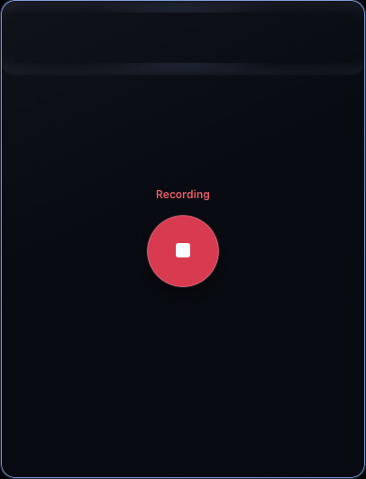

# UltraVox

On-device speech-to-text for dictation and audio files on macOS, Windows, and Linux. Download a model once, then transcribe offline. The MIT-licensed core is free; official builds offer optional Pro features.

<p align="center">
  <a href="https://github.com/michael-berardi/ultravox/releases/tag/v0.13.6"><strong>Download UltraVox</strong></a>
  ·
  <a href="#privacy"><strong>Privacy</strong></a>
  ·
  <a href="#contributing"><strong>Contributing</strong></a>
</p>

<p align="center">
  
</p>

## The core is free; Pro is optional

The UltraVox core is complete, free, and MIT-licensed: transcription, dictation, history, the manual custom dictionary, themes' free set, UltraTerm voice handoff, and the update checker. You never pay for the core.

An optional **UltraVox Pro license** unlocks the Pro features in the official build. Buying one supports signing, notarization, cross-platform packaging, maintenance, and continued improvements; it is not required to use UltraVox.

| | Core (free, open source) | Pro license (optional) |
|---|---|---|
| License | MIT source | Unlocks Pro features in the official build |
| Platforms | macOS arm64, Windows x86_64, Linux x86_64 | Same |
| Transcription | Microphone, local files, and supported URLs | Same |
| Manual custom dictionary | Included; terms and aliases stay on device | Same |
| Retex vocabulary | Not unlocked; Retex is never invoked | macOS: explicitly selected vaults only; read-only local scan |
| Themes | Midnight, Olive, Nord Frost, Vapor, and the other free themes | The complete theme collection |
| Meeting mode | Not unlocked | System audio and microphone capture |
| Lecture mode | Not unlocked | System audio only; microphone excluded |
| Voice Studio | Not unlocked | macOS: on-device voice cloning and speech generation |
| Updates | Public release assets and checksums | Same, plus the authenticated Pareto release channel |

Pro licenses are bought and activated in **Settings → Pro**, which also offers a 14-day trial on the current device. A Pro entitlement is a server-signed, device-bound token; it unlocks Pro features in the official build only.

## Voice Studio

Voice Studio on macOS, part of Pro, is powered by FluidAudio PocketTTS. Create a local voice from dictation recordings or an imported WAV (up to ten seconds of reference audio), then generate 24 kHz mono speech from text using a cloned or built-in voice. Models download on first use; cloning and synthesis run on-device. Clone only voices you have permission to use. See the [Voice Studio guide](docs/voice-studio.md) for language packs, CLI commands, storage, and limitations.

## Requirements

- **macOS:** 14+ on Apple Silicon; macOS 15+ for Meeting mode, Lecture mode, and system-audio capture
- **Linux:** x86_64 with WebKitGTK, compatible with the Ubuntu 22.04 baseline
- **Windows:** Windows 10 or 11 on x86_64, using the NSIS installer
- Microphone permission for speech recording
- Accessibility permission when inserting transcripts into another app or using a modifier-only global shortcut
- Screen Recording permission for Meeting mode and Lecture mode
- Optional on macOS for Pro Retex vocabulary: an installed `retex` command and one or more vault directories explicitly selected in **Settings → Dictionary**

## Install

Download the original-identity [UltraVox v0.13.6 release](https://github.com/michael-berardi/ultravox/releases/tag/v0.13.6) and verify it against the adjacent SHA-256 manifest. This recovery release provides macOS arm64 assets; other platforms must use their latest available platform-specific release.

GitHub's legacy “latest” endpoint is intentionally pinned to v0.13.3, a temporary identity bridge for 0.13.0–0.13.2 updaters—not the public download for new or original-identity users. **0.12.9 users must download and install v0.13.4 directly**: their updater cannot accept or automatically pass through the pinned bridge. If 0.12.10 installs the bridge with only original-identity data, the bridge opens no stores and requests no permissions; it asks for consent to install a verified original-ID final update, with retry/manual-download choices on failure.

| System | Release asset |
| --- | --- |
| macOS | `UltraVox-macos-arm64.zip` or `UltraVox-macos-arm64.pkg` |
| Windows | `UltraVox-windows-x86_64-setup.exe` |
| Linux | `UltraVox-linux-x86_64.AppImage` |

macOS packages are Developer ID signed, notarized by Apple, and staple-verified. The app installs to `/Applications/UltraVox.app`. Building from source gives you the same core without the Pro module; see [Build from source](#build-from-source). The final official app restores the original production identity and settings directory. Development builds use an isolated identity and do not share production OS permission grants. Existing-original users should install the final directly; temporary Pareto-ID users migrate back conservatively before stores open. Native grant retention remains a release verification gate.

`.deb` and `.rpm` packages, when provided, update through the system package manager.

## Quick start

1. Launch UltraVox and grant only the permissions needed for your workflow.
2. Choose an English or multilingual model and let it download.
3. Set a global shortcut in **Settings → Shortcut**.
4. Press the shortcut, speak, then press it again to transcribe.
5. With an active UltraVox Pro license, use **Meeting mode** for system audio plus microphone, or **Lecture mode** for system audio only.

## Privacy

UltraVox sends no telemetry, analytics, crash reports, or unique device identifiers. Transcription and dictionary processing run on your device.

**Network traffic, and when it happens**

- **Update check:** at launch and every four hours, one HTTPS GET to `api.github.com/repos/michael-berardi/ultravox/releases`. It sends the app version in the `User-Agent` and your IP address, which every HTTPS request reveals. It sends no account, machine ID, or install ID. **Settings → Updates → Check for updates** turns these requests off; while off, no check runs and nothing is downloaded automatically.
- **Update download:** only when you click **Update**, or when you have enabled **Automatically update** while the app is idle. The app fetches the release asset and its SHA-256 manifest from `github.com/michael-berardi/ultravox/releases` and verifies the checksum before installing. The host sees your IP.
- **Models:** only when you click **Download** for a model. Phonon-2 is fetched from `huggingface.co/FermionResearch/Phonon-2` and checked against pinned SHA-256 hashes. Multilingual model packs are fetched from Hugging Face by the native bridge or the HTTP downloader; this source pins no checksum for those packs. No model is downloaded at startup.
- **Media URL import:** only when you paste a URL and start an import. The `yt-dlp` tool you install connects to the site you named and its media hosts; those hosts see your IP and the URL you entered. UltraVox does not send your recordings or transcripts to them.
- **Pro and licensing:** this open-source build has locked Pro stubs and makes no license, entitlement, or private-update requests. Official Pro builds use a separately supplied module; activation and any private release channel are user-initiated and are not part of this source tree.

**What stays local**

Data lives in the Tauri application data directory for `com.imploselabs.ultravox` (override with `ULTRAVOX_DATA_DIR`). `settings.toml` holds settings, shortcuts, the manual dictionary, and any vault permissions you granted. `recordings.sqlite` holds timestamps, titles, previews, full transcripts, and local source paths; `recordings/` holds the audio. `models/` holds downloaded models, and `update-preferences.json` holds your update choices. The voice socket in the user temp directory lets paired local tools start dictation and read the resulting transcript; it is a local Unix socket, not a network service. On Unix, the app data directory and its subdirectories are set to 0700 and settings, history, audio, and preference files to 0600; other platforms use their native per-user protections. Errors are printed to the app's own stderr; UltraVox writes no log file with transcripts or secrets. History is kept until you delete it; transient import files are removed after import and at startup.

**Deleting it:** History → **Delete all** removes recordings, transcripts, and their audio from the app. Deleting the application data directory removes everything else, including settings, update preferences, and models. Exported files, backups, and files you supplied for import are outside that directory and must be deleted separately.

Manual dictionary text never leaves the device. In an official Pro build, Retex vocabulary is read-only and only runs after you select a vault in **Settings → Dictionary**; transcript text is not passed to Retex. Meeting capture and Voice Studio exist only in official Pro builds; their local data is described in [docs/voice-studio.md](docs/voice-studio.md).

## Updates

UltraVox checks for stable updates at launch and every four hours against the public release assets of the canonical repository. **Settings → Updates → Check for updates** turns those checks off. When a newer version exists, an **Update** button appears in the window's top bar; click it to download, verify, install and relaunch. **Settings → Updates → Automatically update** installs new versions on its own, but only while UltraVox is idle: never during a recording, meeting, transcription or import. Every candidate must pass its immutable SHA-256 manifest; macOS additionally requires the canonical Developer ID, sealed code, designated requirement, and notarization ticket. Licensed installs may also use the authenticated Pareto channel. Failed verification leaves the installed version untouched.

## Licensing

UltraVox source is available under the [MIT License](LICENSE). The Pro module linked into official builds is proprietary: it is not part of this repository and is licensed separately by Pareto Cybernetics. Pro services, private release infrastructure, and commercial entitlements are provided separately as well.

The MIT license does not grant rights to the UltraVox or Pareto Cybernetics names, logos, or other brand assets. Third-party rights remain with their respective owners. See [LEGAL_NOTICES.md](LEGAL_NOTICES.md) and [`apps/desktop/LEGAL_NOTICES.md`](apps/desktop/LEGAL_NOTICES.md) for bundled notices.

No secrets, signing identities, or service credentials belong in the public repository.

## Build from source

The commands below target macOS with Homebrew and Xcode Command Line Tools. They require Node.js 22, pnpm 10.27.0, Rust, CMake, and libomp. Windows and Linux need their platform-specific Tauri prerequisites.

```bash
export DO_NOT_TRACK=1 HOMEBREW_NO_ANALYTICS=1
git clone --recurse-submodules https://github.com/michael-berardi/ultravox.git
cd ultravox
brew install cmake libomp rust node@22
export PATH="$(brew --prefix node@22)/bin:$PATH"
npm install --global pnpm@10.27.0
pnpm install --frozen-lockfile

# Checks and tests (Rust tests require the generated frontend assets)
pnpm desktop:check
pnpm --filter ultravox-desktop build
cargo test --workspace -j4
pnpm --filter ultravox-desktop test

# Build the open-source app (Pro module not included)
CARGO_BUILD_JOBS=4 pnpm --filter ultravox-desktop tauri build --no-default-features --features custom-protocol
```

Source builds do not include the Pro module. Do not install a locally built app over an official installation when testing macOS permission continuity: signing identity affects permission grants.

`pnpm test:all` currently includes a release contract that requires a publishing script absent from this public repository. Use the separate checks above for public-source contributions.

## Architecture

- **Tauri + React** provide the desktop shell and accessible interface.
- **Rust** handles application state, audio, history, in-memory dictionary processing, permissioned Retex command invocation, downloads, and CLI tooling.
- **Swift/FluidAudio bridges** provide native macOS transcription, permissions, accessibility, meetings, and system audio.
- **Phonon-2** (a 164 MB English model by Fermion Research, run in-process on the CPU) provides English transcription on macOS, Windows and Linux; **Whisper.cpp** provides multilingual transcription on Windows and Linux.
- **The Pro module** (`apps/desktop/src-tauri/src/pro/`, `apps/desktop/src/pro/`) is compiled only into official builds and stays locked without a valid entitlement; the open-source build links stubs in its place.

Optional platform integrations degrade safely when metadata or permissions are unavailable. Transcription history and audio stay on the device.

## Contributing

Issues and focused pull requests are welcome.

1. Search existing issues before opening a duplicate.
2. Describe the user-visible behavior, operating system version, and reproduction steps.
3. Keep changes scoped and include tests for new observable behavior.
4. Run the checks in [Build from source](#build-from-source) before submitting.

Please do not include recordings, transcripts, credentials, private URLs, or personal system details in issues.

## License and acknowledgements

UltraVox source is available under the [MIT License](LICENSE); the Pro module in official builds is proprietary and licensed separately. It builds on open-source work including:

- [OpenSuperWhisper](https://github.com/Starmel/OpenSuperWhisper)
- [whisper.cpp](https://github.com/ggerganov/whisper.cpp)
- [Phonon-2](https://huggingface.co/FermionResearch/Phonon-2) by Fermion Research (CC-BY-4.0, derived from NVIDIA Parakeet TDT 0.6B v3; native engine Apache-2.0)
- [FluidAudio](https://github.com/FluidInference/FluidAudio)
- [autocorrect](https://github.com/huacnlee/autocorrect)
- [voice-glow](https://libraries.dev/voice) by Jakub Antalik (MIT)

Third-party licenses and notices remain with their respective projects. See [`apps/desktop/LEGAL_NOTICES.md`](apps/desktop/LEGAL_NOTICES.md) for bundled notices.
